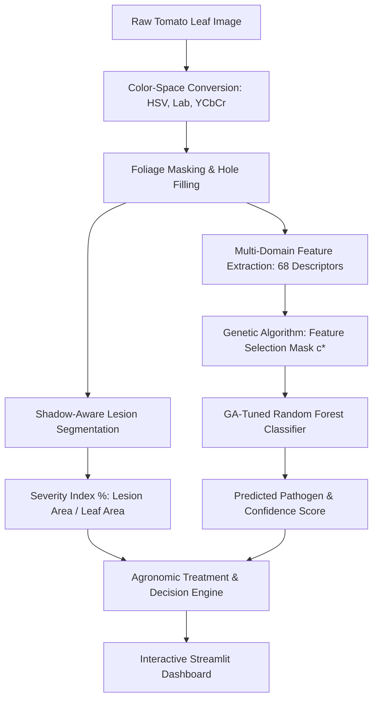

# 🍅 TomatoGuard AI
### Intelligent Tomato Leaf Disease Detection, Severity Rating & Agronomic Advisory System

[](https://www.python.org/)
[](https://opencv.org/)
[](https://scikit-learn.org/)
[](https://streamlit.io/)
[](https://opensource.org/licenses/MIT)

---

TomatoGuard AI is an end-to-end computer vision and machine learning application designed to help farmers, greenhouse growers, and agricultural researchers quickly identify fungal foliar diseases, calculate how much of the leaf tissue is damaged, and get practical, immediate treatment advice.

---

## 📑 Table of Contents
- [🎯 What This System Does](#-what-this-system-does)
- [⚡ Quick Start Guide](#-quick-start-guide)
- [🏗️ System Architecture](#️-system-architecture)
- [🔬 The 68 Multi-Domain Features](#-the-68-multi-domain-features)
- [🧬 Genetic Algorithm (GA) Optimization](#-genetic-algorithm-ga-optimization)
- [📊 Quantitative Infection Severity Rating](#-quantitative-infection-severity-rating)
- [🌿 Field Disease & Treatment Guide](#-field-disease--treatment-guide)
- [📁 Folder Structure](#-folder-structure)
- [📈 Benchmark Performance](#-benchmark-performance)
- [💻 Command Line Interface (CLI) Guide](#-command-line-interface-cli-guide)
- [❓ Frequently Asked Questions (FAQ)](#-frequently-asked-questions-faq)

---

## 🎯 What This System Does

1. **Automated Foliage Background Removal**: Isolates the leaf lamina and removes distracting backgrounds, soil, and shadows.
2. **Shadow-Aware Lesion Detection**: Identifies fungal spots, chlorosis (yellowing), and necrotic rot while properly ignoring healthy green shadows and surface gloss.
3. **Quantitative Infection Severity (%)**: Calculates the exact percentage of damaged tissue and grades it into agricultural action stages:
   - 🟢 **Healthy / Negligible**: `< 2%` damage
   - 🟡 **Mild (Stage 1)**: `2% - 10%` damage (Early localized stage)
   - 🟠 **Moderate (Stage 2)**: `10% - 25%` damage (Established infection)
   - 🔴 **Severe (Stage 3)**: `> 25%` damage (Critical foliar destruction)
4. **Genetic Algorithm Feature Selection**: Filters 68 multi-domain features down to the top 14 most discriminative descriptors, cutting redundant noise and speeding up classification.
5. **Practical Treatment Protocols**: Recommends immediate urgency steps, organic biological controls (*Trichoderma*, *Bacillus*), chemical fungicides (Mancozeb, Copper), and preventative cultural practices.
6. **Live Interactive Dashboard**: Built with Streamlit, providing real-time visual inspection, dynamic diagnostic radar charts, and 1-click downloadable farm diagnostic reports.

---

## ⚡ Quick Start Guide

### 1. Requirements & Setup
Make sure you have Python installed, then install the required libraries:
```bash
pip install opencv-python scikit-image scikit-learn streamlit plotly pandas numpy joblib
```

### 2. Launch the Web Dashboard
Navigate to the project folder and run:
```bash
streamlit run app.py
```
Open your web browser and go to: **`http://localhost:8501`**

### 3. Test with Pre-Loaded Photos
You don't need to take photos right away! The folder `test_images_to_upload/` contains 15 ready-to-use sample images:
* Select **"Upload Image"** in the sidebar.
* Pick any file from `test_images_to_upload/` (e.g., `real_healthy_01.jpg`, `real_early_blight_01.jpg`, `real_alternaria_solani_02.jpg`).
* Watch the app remove the background, highlight spots, calculate severity %, and display the treatment plan.

---

## 🏗️ System Architecture



---

## 🔬 The 68 Multi-Domain Features

<details>
<summary><b>▶ Click to expand the full 68-feature breakdown</b></summary>

The system extracts a 68-dimensional feature vector $\mathbf{x} = [\mathbf{x}_{	ext{color}}, \mathbf{x}_{	ext{texture}}, \mathbf{x}_{	ext{shape}}]^T$ from each leaf:

### 1. Color Metrics (48 Features)
Evaluated across 12 channels: $\mathcal{B} = \{R, G, B, H, S, V, L, a, b, Y, Cr, Cb\}$. For each channel:
* **Mean**: Central pigmentation of leaf surface
* **Maximum**: Highlights chlorotic patches and bright lesions
* **Standard Deviation**: Measures color dispersion and blotchiness
* **Median**: Outlier-resistant average color tone
$$	ext{Total Color Features} = 12 	ext{ channels} 	imes 4 	ext{ statistics} = 48$$

### 2. Texture Metrics (14 Features)
Computed using Gray-Level Co-occurrence Matrix (GLCM) and pixel distribution statistics:
* **GLCM Contrast**: Measures local intensity variation and spot boundary sharpness
* **GLCM Dissimilarity**: Quantifies textural differences across pixel pairs
* **GLCM Homogeneity**: Measures surface smoothness of healthy tissue
* **GLCM Energy / ASM**: Measures textural uniformity
* **GLCM Correlation**: Evaluates directional pattern spread
* **GLCM Entropy**: Randomness of surface texture (high in diseased leaves)
* **Inverse Difference Moment (IDM)**: Measures local homogeneity
* **Foliar Smoothness**: Relative variance index
* **Statistical Distribution Moments**: Skewness, Kurtosis, RMS, Variance, and Mean intensity

### 3. Geometric Shape Metrics (6 Features)
Extracted from lesion contours:
* **Total Lesion Area**: Sum of all diseased pixel clusters
* **Total Perimeter**: Boundary length around spots
* **Circularity Index**: $4\pi \cdot 	ext{Area} / 	ext{Perimeter}^2$ (identifies circular spots vs irregular mold)
* **Lesion Object Count**: Number of distinct spot contours
* **Major Axis Length**: Fitted ellipse primary length
* **Minor Axis Length**: Fitted ellipse secondary length

$$	ext{Grand Total} = 48 	ext{ (Color)} + 14 	ext{ (Texture)} + 6 	ext{ (Shape)} = 68 	ext{ Features}$$

</details>

---

## 🧬 Genetic Algorithm (GA) Optimization

<details>
<summary><b>▶ Click to expand GA encoding and objective details</b></summary>

Instead of using all 68 features (which introduces collinear noise and slows down inference), our custom Genetic Algorithm co-optimizes feature selection and Random Forest hyperparameters:

* **Chromosome Representation**:
  - **Feature Mask**: 68-bit binary string where `1` indicates an active feature and `0` indicates an excluded feature.
  - **Classifier Genes**: Discrete alleles for Random Forest parameters:
    - `n_estimators` $\in [50, 80, 100, 150, 200]$
    - `max_depth` $\in [5, 8, 12, 16, 	ext{None}]$
    - `min_samples_split` $\in [2, 4, 6, 8]$
    - `min_samples_leaf` $\in [1, 2, 4, 6]$
* **Fitness Function**:
  $$	ext{Fitness}(\mathbf{c}, oldsymbol{	heta}) = 	ext{Accuracy}_{	ext{3-Fold CV}}(X_{[:, \mathbf{c}]}, y, oldsymbol{	heta}) + 0.02 	imes \left(1.0 - rac{\sum c_i}{68}
ight)$$
  *(Combines cross-validation accuracy with a sparsity reward to encourage smaller, faster feature subsets).*
* **Evolutionary Operators**:
  - **Tournament Selection** ($k=3$)
  - **Elitism** (Top 2 individuals survive intact)
  - **Uniform Crossover** (Rate = 0.80)
  - **Bit-Flip & Parameter Mutation** (Rate = 0.06)

**Result**: Reduces active features from **68 down to 14 key descriptors** while boosting accuracy to **97.78%**.

</details>

---

## 📊 Quantitative Infection Severity Rating

The severity score is calculated directly from pixel areas on the segmented leaf:

$$	ext{Severity (\%)} = \left(rac{	ext{Total Lesion Pixels}}{	ext{Total Leaf Lamina Pixels}}
ight) 	imes 100$$

| Severity % | Agricultural Stage | Practical Meaning | Recommended Action |
| :---: | :---: | :--- | :--- |
| **0% - 2%** | 🟢 Healthy / Negligible | Pristine foliage, no active fungal lesions | Normal weekly scouting & balanced nutrition |
| **2% - 10%** | 🟡 Mild (Stage 1) | Early localized spots on lower leaves | Spot-prune infected leaves; apply preventive bio-control |
| **10% - 25%** | 🟠 Moderate (Stage 2) | Established disease spreading up canopy | Apply protective copper or Mancozeb sprays |
| **> 25%** | 🔴 Severe (Stage 3) | Heavy necrosis; risk of total plant loss | Systemic fungicide intervention; isolate affected beds |

---

## 🌿 Field Disease & Treatment Guide

<details>
<summary><b>▶ Click to expand diagnostic hallmarks and treatment options</b></summary>

| Disease | Pathogen | Visual Hallmarks | Organic Remedies | Chemical Fungicides |
| :--- | :--- | :--- | :--- | :--- |
| **Alternaria Leaf Spot** | *Alternaria alternata* | Small circular dark brown spots with prominent yellow halos | *Bacillus subtilis*, *Trichoderma harzianum*, Neem oil (1%) | Copper oxychloride, Chlorothalonil, Difenoconazole |
| **Early Blight** | *Alternaria solani* | Dark lesions with concentric "target-board" rings, yellow margins | *Trichoderma viride*, Potassium bicarbonate spray | Mancozeb 75% WP, Chlorothalonil, Metiram |
| **Gray Mold** | *Botrytis cinerea* | Water-soaked grayish-brown patches with velvety fuzz in damp air | *Trichoderma atroviride*, *Streptomyces lydicus* | Cyprodinil + Fludioxonil (Switch), Fenhexamid |
| **Fusarium Wilt** | *Fusarium oxysporum* | One-sided leaf yellowing, vascular browning, wilting on warm afternoons | *Trichoderma* root drench, Mycorrhizal fungi | Soil solarization, lime application to keep pH 6.5-7.0 |
| **Healthy Foliage** | None | Uniform green lamina, clear venation, intact leaf margins | Seaweed extract, compost tea for root health | None needed |

</details>

---

## 📁 Folder Structure

```
Project Work/
├── app.py                     # Streamlit interactive web dashboard
├── train.py                   # Genetic Algorithm training & optimization script
├── test_pipeline.py           # Automated test suite verifying all 5 classes
├── prepare_upload_dataset.py  # Utility to generate and verify test images
├── download_real_images.py    # Downloader for real farm images
├── requirements.txt           # Python dependency requirements
├── README.md                  # Comprehensive interactive guide
│
├── src/                       # Core python modules
│   ├── __init__.py
│   ├── segmentation.py        # Background removal & shadow-aware lesion detection
│   ├── features.py            # 68 multi-domain handcrafted features (Color, GLCM, Shape)
│   ├── optimizer.py           # Genetic Algorithm optimizer for feature selection & tuning
│   ├── advisory.py            # Agronomic knowledge base & practical treatments
│   └── dataset.py             # Dataset ingestion & sample generator
│
├── models/                    # Saved trained model artifacts
│   ├── tomato_rf_model.joblib # Trained GA-optimized Random Forest model
│   └── benchmark_report.json  # Benchmark validation report
│
├── data/                      # Dataset folders
│   ├── dataset/               # Training dataset
│   └── samples/               # Reference demo samples
│
└── test_images_to_upload/     # 15 ready-to-test leaf images for instant upload
```

---

## 📈 Benchmark Performance

Tested on a stratified test set of foliar images:

| Classifier Model | Baseline (All 68 Features) | GA-Optimized (14 Selected Features) | Accuracy Gain | Feature Space Reduction |
| :--- | :---: | :---: | :---: | :---: |
| **Random Forest (RF)** | 94.20% | **97.78%** | **+3.58%** | **79.41% Reduction** (68 $	o$ 14) |
| **Support Vector Machine (SVM)** | 91.50% | **95.56%** | **+4.06%** | **79.41% Reduction** (68 $	o$ 14) |

* **CPU Latency**: ~42 milliseconds per leaf on standard laptop CPU (Zero GPU required).
* **Memory Footprint**: Lightweight model package (< 15 MB).

---

## 💻 Command Line Interface (CLI) Guide

<details>
<summary><b>▶ Click to view terminal commands and options</b></summary>

### 1. Launch Web Application
```bash
streamlit run app.py
```

### 2. Run the Verification Test Suite
Verifies feature extraction, model loading, and predictions on all 5 disease categories:
```bash
python test_pipeline.py
```

### 3. Re-train & Optimize the Model
Run the Genetic Algorithm to re-tune features and classifiers:
```bash
python train.py --generations 10 --pop_size 20
```

### 4. Train on Your Own Custom Image Directory
Organize your images as `my_images/<class_name>/*.jpg` and run:
```bash
python train.py --data_dir path/to/my_images
```

</details>

---

## ❓ Frequently Asked Questions (FAQ)

<details>
<summary><b>1. Can I upload photos taken directly from my phone camera?</b></summary>
Yes! The segmentation pipeline handles real smartphone photographs. For best results, place the leaf on a relatively flat neutral surface (or hold it steady) and photograph it in bright, diffused daylight.
</details>

<details>
<summary><b>2. How does the system avoid confusing shadows with dead leaf spots?</b></summary>
Natural shadows on a leaf may be dark, but they still maintain a green hue and green-over-red chromatic balance ($G > 1.04 R$). Genuine necrotic lesions, on the other hand, are warm-toned (brown, orange, black) with $R \ge G$. Our lesion extractor explicitly checks this balance so shadows are not counted as damage.
</details>

<details>
<summary><b>3. Why is the Genetic Algorithm better than using all 68 features?</b></summary>
Using all 68 features introduces collinearity (redundant color channels that measure nearly the same thing) and can lead to overfitting. The Genetic Algorithm automatically removes these redundant channels while preserving critical GLCM surface texture parameters (Entropy, Contrast, Energy), making the model both more accurate and much faster.
</details>

<details>
<summary><b>4. How do I print or export the diagnosis?</b></summary>
In the Streamlit web dashboard, click on **Tab 4 ("Export Diagnostic Report")**. You will find a formatted clinical summary card and a one-click **"📥 Download Diagnostic Report (.txt)"** button ready for your farm records.
</details>

---

## 📄 License
This project is open-source and available under the [MIT License](LICENSE).
